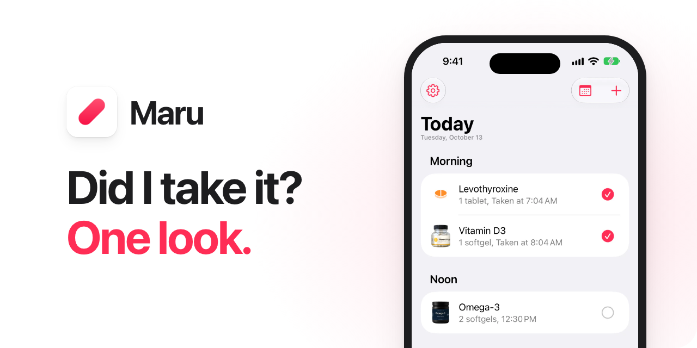
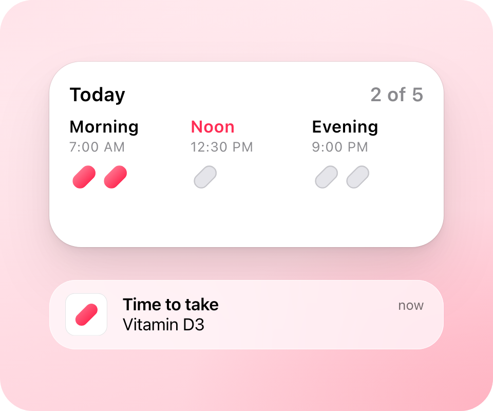
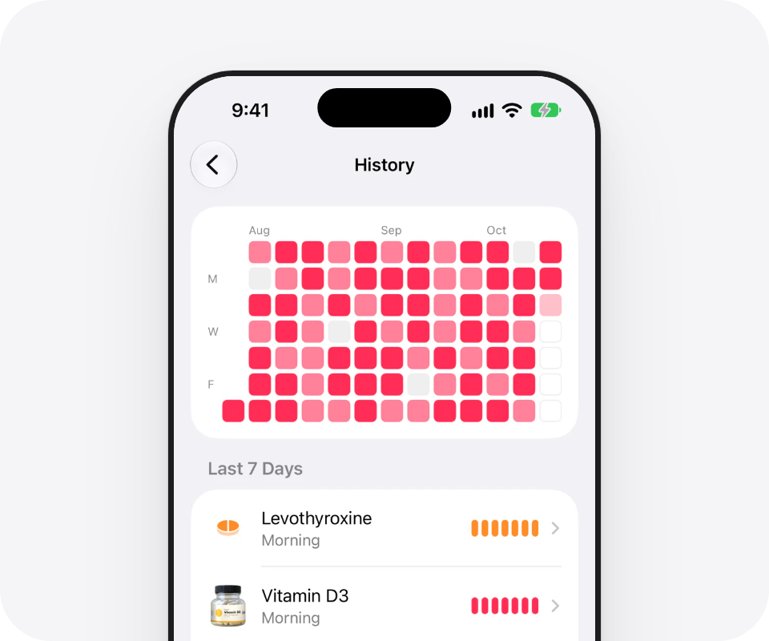

<p align="center">
  <a href="https://maru.day"><picture>
    <source media="(prefers-color-scheme: dark)" srcset="docs/images/hero-dark.png">
    
  </picture></a>
</p>

<p align="center">
  Maru reminds you to take your vitamins, supplements, and medicine.<br>
  One tap records what you took.
</p>

<p align="center">
  <a href="https://maru.day">Website</a>&nbsp;&nbsp;&nbsp;&nbsp;
  <a href="https://maru.day/faq/">FAQ</a>&nbsp;&nbsp;&nbsp;&nbsp;
  <a href="https://maru.day/privacy/">Privacy</a>&nbsp;&nbsp;&nbsp;&nbsp;
  <a href="https://maru.day/support/">Support</a>
</p>

<p align="center">
  Coming soon to the App Store, for iPhone and iPad.
</p>

<p align="center">
  <picture>
    <source media="(prefers-color-scheme: dark)" srcset="docs/images/reminders-dark.png">
    
  </picture>
  <picture>
    <source media="(prefers-color-scheme: dark)" srcset="docs/images/history-dark.png">
    
  </picture>
</p>

<p align="center">
  <b>Reminders.</b> Maru reminds you at your times.<br>
  <b>History.</b> You see each day that you recorded.
</p>

- Free to download. Reminders, records, widgets, export, and backup are free, with no limit on items. No ads. Maru Pro is optional.
- No account.
- Your records stay on your device. Usage statistics are optional: see [PRIVACY.md](PRIVACY.md).
- Six languages: English, Simplified Chinese, Japanese, Spanish, German, and Korean.
- Maru gives no medical advice.

## Build

Use a Mac with Xcode 27 or later.

```sh
brew install xcodegen
xcodegen generate
open Maru.xcodeproj
```

Run the tests of the core logic:

```sh
swift test --package-path Packages/MaruKit
```

## Security

Report a security problem as [SECURITY.md](SECURITY.md) describes.

## License

Copyright 2026 Hang Li. All rights reserved.
