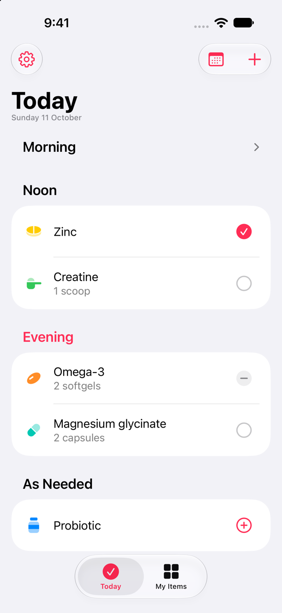
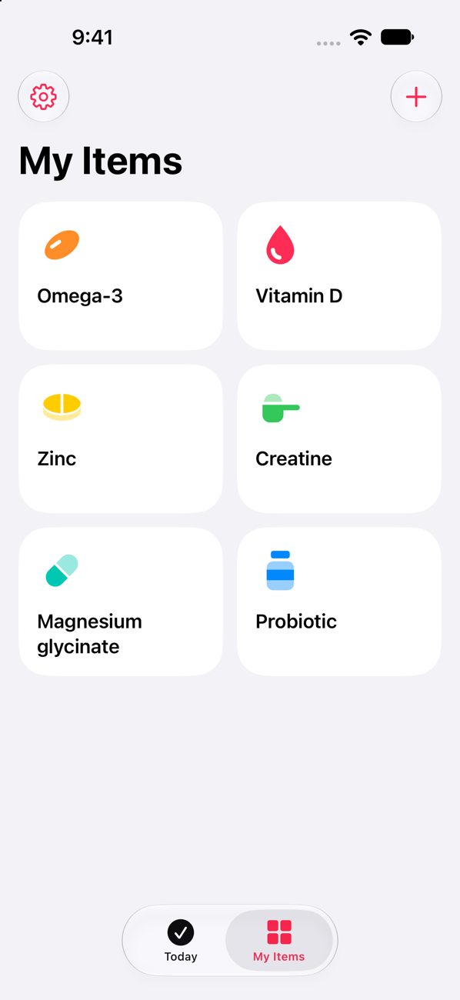
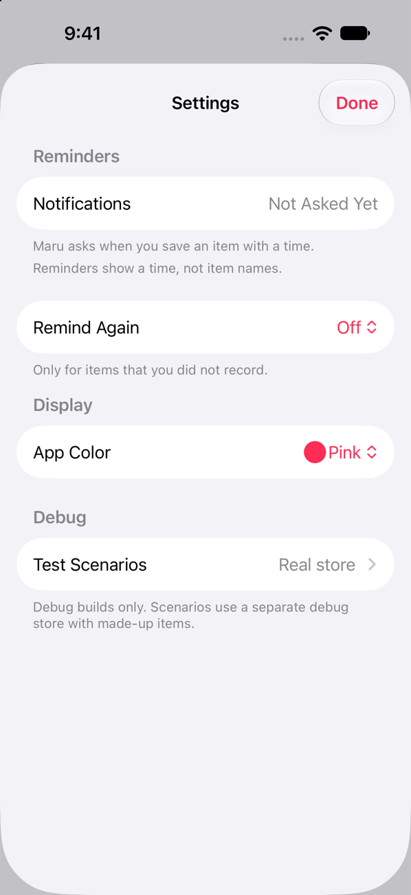
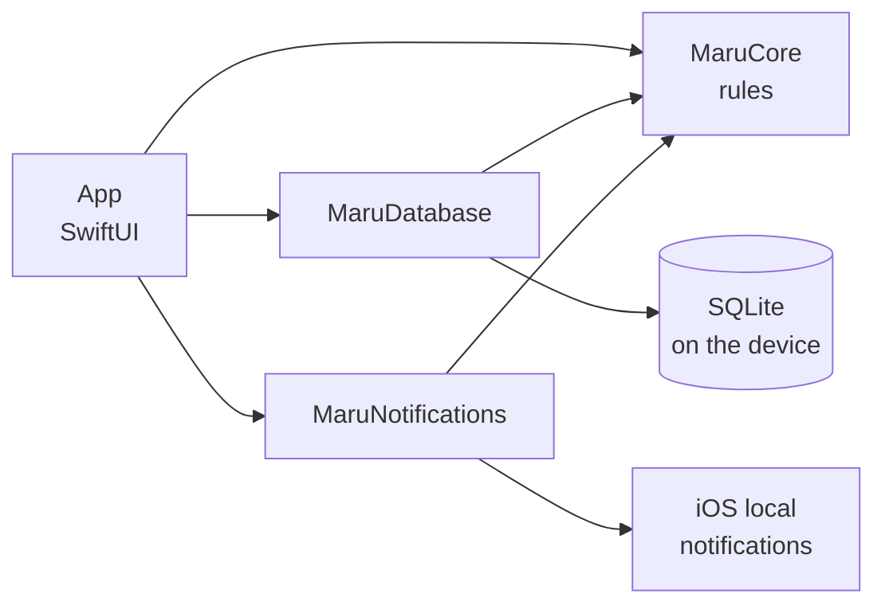

<p align="center">
  
</p>

<h1 align="center">Maru</h1>

<p align="center">Remember what you take. Nothing more.</p>

<p align="center">
  <a href="https://github.com/ImHangLi/maru/actions/workflows/ci.yml"></a>
  <a href="LICENSE"></a>
</p>

Maru is a small iPhone app for daily supplements and simple medication schedules. It reminds you on time, shows what to take now, and keeps a record you can trust.

Your data stays on your iPhone. Maru has no account, no cloud, no ads, and no tracking. A missed dose is only a missed dose. There are no streaks, no scores, and no guilt. The app uses native iOS components only, so it feels like part of the system.

<p align="center">
  
  
  
  
</p>

## Features

- **Today.** One section for each part of the day. Tap the circle to record a dose. Record a whole section with one tap.
- **Reminders on time.** Local notifications at the times you choose. An optional second reminder, off by default.
- **History.** See what you took and when. Undo or correct a record.
- **As needed.** Record an item with no schedule at the current time.
- **Travel.** A medication can keep the clock of its home time zone.
- **Your choices only.** Maru never picks a dose or a medication time for you.
- **For everyone.** Text at every size, VoiceOver, Dark Mode, and an app color that you choose.

Maru is in early development and is not on the App Store yet.

## Questions

Why not Apple Health or an alarm? What if I forget to record? Read [the short answers](docs/faq.md).

## Privacy

Maru stores everything on your iPhone. Your items and records are in a local database, protected by iOS file encryption. It makes no network requests by itself and contains no analytics. The only web page is the feedback form, which opens when you tap it. Reminders are local notifications. Read [PRIVACY.md](PRIVACY.md) for the details.

## Build

You need a Mac with Xcode 27 or later and [XcodeGen](https://github.com/yonaskolb/XcodeGen).

```sh
brew install xcodegen
git clone https://github.com/ImHangLi/maru.git
cd maru
xcodegen generate
open Maru.xcodeproj
```

Select the Maru scheme and an iPhone simulator, then press Cmd-R.

To run Maru on your own iPhone, a free Apple ID is enough:

1. In Xcode, open Settings > Accounts and add your Apple ID.
2. In the Maru target, open Signing & Capabilities and select your personal team.
3. Change the bundle identifier to one that you own, for example `com.yourname.maru`.

A build signed with a free Apple ID stops after seven days. Run it again from Xcode to renew it.

The core logic builds and tests on a Mac without a simulator:

```sh
swift test --package-path Packages/MaruKit
```

## Project layout

```text
App/                    SwiftUI app: views and app wiring
Packages/MaruKit/
  MaruCore              Items, schedules, and record rules. No UI, no third-party code
  MaruDatabase          The local SQLite store (GRDB)
  MaruNotifications     Local reminders
docs/                   Spec, design rules, decisions, and research
project.yml             XcodeGen project definition
```



The views call domain operations. They never write to the database directly.

## Docs

- [Spec](docs/spec.md): scope, data model, and acceptance checks (in Simplified Chinese).
- [Design](docs/design.md): the visual rules.
- [Decisions](docs/decisions.md): numbered decisions and their reasons.
- [How we work](docs/process.md): records and the flow for one change.

## Contributing

Bug reports and ideas are welcome. Read [CONTRIBUTING.md](CONTRIBUTING.md) before you send code. Report a security problem privately, as [SECURITY.md](SECURITY.md) describes.

## License

[MIT](LICENSE)
