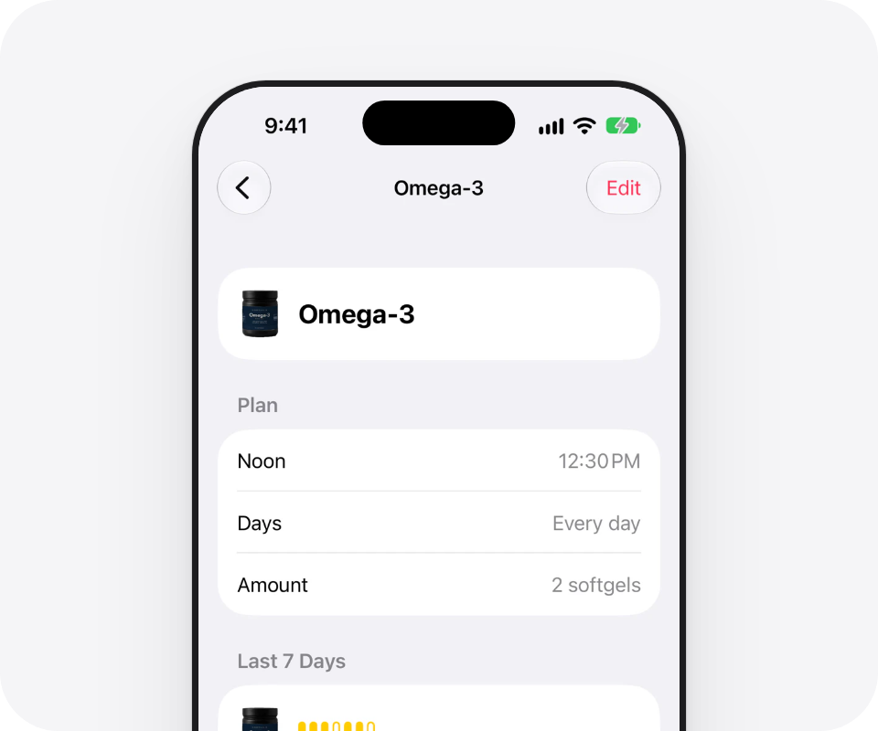

<p align="center">
  
</p>

<h1 align="center">Maru</h1>

<p align="center">
  <b>Did I take it? One look.</b><br>
  Maru reminds you to take your vitamins, supplements, and medicine.<br>
  One tap records what you took.
</p>

<p align="center">
  <a href="https://maru.day">Website</a>&nbsp;&nbsp;&nbsp;&nbsp;
  <a href="https://maru.day/faq/">FAQ</a>&nbsp;&nbsp;&nbsp;&nbsp;
  <a href="https://maru.day/privacy/">Privacy</a>&nbsp;&nbsp;&nbsp;&nbsp;
  <a href="https://maru.day/support/">Support</a>
</p>

<p align="center">
  <a href="https://maru.day"></a>
</p>

<p align="center">
  Coming soon to the App Store, for iPhone and iPad. Read more at <a href="https://maru.day">maru.day</a>.
</p>

<table>
  <tr>
    <td width="50%" valign="top">
      
      <h3>Reminders and today at a glance</h3>
      <p>Maru reminds you at your times, and the widget shows your day.</p>
    </td>
    <td width="50%" valign="top">
      
      <h3>See what you took</h3>
      <p>See months at a glance, and the last seven days of every item.</p>
    </td>
  </tr>
  <tr>
    <td width="50%" valign="top">
      
      <h3>Check times and amounts</h3>
      <p>See its times, its amount, and its last seven days.</p>
    </td>
    <td width="50%" valign="top">
      
      <h3>Your bottle, your icon</h3>
      <p>Take or choose a photo of your own bottle, and it becomes the item icon. The photo stays on your device.</p>
    </td>
  </tr>
</table>

## Good to know

- **Free and open source.** No subscription, no ads, and no limit on items.
- **No account.** Open Maru and add what you take.
- **Your records stay on your device.** Maru has no server and no sync between devices. Some versions can send simple usage statistics that never include item names, doses, or intake times, and a switch in Settings turns them off. [PRIVACY.md](PRIVACY.md) has the details.
- **Six languages.** English, Simplified Chinese, Japanese, Spanish, German, and Korean.
- **iPhone and iPad.** The Apple Watch app is in this repository, but it is not in version 1.0.
- **No medical advice.** Maru never picks a dose or a time for you.

More answers are in the [FAQ](https://maru.day/faq/).

## For developers

You need a Mac with Xcode 27 or later and [XcodeGen](https://github.com/yonaskolb/XcodeGen).

```sh
brew install xcodegen
git clone https://github.com/ImHangLi/maru.git
cd maru
xcodegen generate
open Maru.xcodeproj
```

Select the Maru scheme and an iPhone or iPad simulator, then press Cmd-R. To run Maru on your own iPhone with a free Apple ID, select your personal team in Signing & Capabilities and change the bundle identifier to one that you own.

The core logic builds and tests on a Mac without a simulator:

```sh
swift test --package-path Packages/MaruKit
```

### Layout

```text
App/                SwiftUI app: views and app wiring
Widget/             Home Screen widgets
Watch/              Apple Watch app (not in version 1.0)
Shared/             Code that the app, the widgets, and the Watch app share
Packages/MaruKit/   MaruCore (rules, no UI), MaruDatabase (SQLite with GRDB),
                    MaruNotifications (local reminders), MaruAnalytics (usage statistics)
site/               The landing site at maru.day
docs/               Spec, design rules, and decisions
project.yml         XcodeGen project definition
```

The views call domain operations. They never write to the database directly. [docs/spec.md](docs/spec.md) is the source of truth for scope (in Simplified Chinese), and [docs/decisions.md](docs/decisions.md) has the numbered decisions and their reasons.

### Contribute

Bug reports and ideas are welcome. Read [CONTRIBUTING.md](CONTRIBUTING.md) before you send code. Report a security problem privately, as [SECURITY.md](SECURITY.md) describes.

### License

[MIT](LICENSE)
